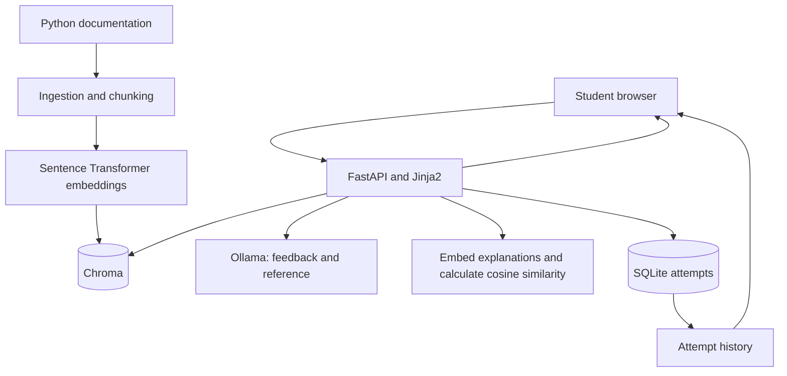

# PyForge

PyForge is a local Python practice application. Students submit code and
explain concepts in their own words, receive AI coaching feedback, and
review their previous attempts.

The learning goal is to combine explanation, practice, review, and
progression to harder examples.

## MVP features

- Five exercises covering dictionaries, lists, functions, and tuples.
- A harder List exercise that introduces changing an item by index.
- Separate AI feedback on code and explanations.
- Related Python documentation retrieved through LangChain and Chroma.
- AI-generated reference explanations.
- Semantic similarity between student and reference explanations.
- SQLite storage of code, explanations, feedback, references, scores,
  and timestamps.
- Attempt history for each exercise.
- Manual navigation to review a topic or try its linked harder example.

## Tested environment

- Python 3.12.3
- uv 0.12.15
- Ollama model: llama3.1:8b

## Technology

- FastAPI and Jinja2: application routes and HTML pages.
- Ollama: coaching feedback and reference generation.
- LangChain and Sentence Transformers: text splitting and embeddings.
- Chroma: documentation vector storage and retrieval.
- SQLite: persistent attempt history.
- scikit-learn: cosine similarity.

## Setup

Run commands from the project root.

1. Install project dependencies:

   ```bash
   uv sync
   ```

2. Install Ollama, start its service, and download the model:

   ```bash
   ollama pull llama3.1:8b
   ```

3. Create a `.env` file:

   ```text
   OLLAMA_MODEL=llama3.1:8b
   ```

4. Place the Python documentation text file at:

   ```text
   docs_corpus/tutorial/datastructures.txt
   ```

   Documentation downloads: https://docs.python.org/3/download.html

5. Build the documentation index:

   ```bash
   uv run python scripts/ingest_docs.py
   ```

6. Start the application:

   ```bash
   uv run uvicorn pyforge.main:app --reload --app-dir src
   ```

7. Open http://127.0.0.1:8000.

The application initializes the SQLite tables on startup.
The embedding model may download on first use.

## Architecture



## Demo

1. Select List.
2. Submit a list example and an explanation in your own words.
3. Review code feedback, explanation feedback, documentation,
   and semantic similarity.
4. Return to the topic and inspect the saved attempt.
5. Submit a revised explanation and compare the attempts.
6. From the basic List feedback page, select Try a harder example.
7. Complete the exercise that changes an existing list item.

## Assessment limitations

Semantic similarity is not a correctness or mastery score.
Testing showed that an incorrect explanation could score higher than
a correct paraphrase. It does not automatically advance students.

AI feedback and generated references can contain errors.
Documentation retrieval may return a passage that is related to the
topic but does not address the specific operation.

Submitted code is reviewed as text; the application does not execute it.
The MVP uses shared local history and has no user accounts.

## Future work

- Persist review and progression choices.
- Automatically resurface topics for spaced review.
- Assess mastery using multiple sources of evidence.
- Present harder examples after demonstrated mastery.
- Improve documentation coverage and retrieval relevance.
- Provide a feedback panel with inline explanation revision.